# Awesome-AMQP-Client-Libraries

  

  
  
  
  
  
  

---

## 🌐 Top AMQP Client Libraries & Message Brokers Ecosystem

> **Curated List of Production-Ready SaaS Platforms, High-Throughput Open-Source GitHub Projects, and Client Library Abstractions for AMQP 0-9-1 & AMQP 1.0.**  
> *Last updated: October 2026* 📅

Welcome to the definitive, SEO-optimized directory of **AMQP (Advanced Message Queuing Protocol)** client libraries, distributed message brokers, cloud queuing platforms, and event routing systems. Whether you are building asynchronous microservices in Python, Node.js, Go, C#, C++, Java, or orchestrating distributed background jobs at enterprise scale, this guide delivers deep technical benchmarks, pricing models, and direct repository insights.

🚀 **Key Highlights & Implementations:**
- **Languages Supported**: Python, Go, Node.js / TypeScript, Java, C#, C/C++, Rust, and Erlang
- **Protocols Covered**: AMQP 0-9-1, AMQP 1.0, MQTT 5.0, STOMP, OpenWire, JMS 2.0
- **Popular Technologies**: Celery, Kombu, Pika, RabbitMQ, Apache ActiveMQ Classic & Artemis, Qpid Proton, Azure Service Bus, Amazon SQS, Google Cloud Pub/Sub, Redis Streams

---

## 📑 Table of Contents

- [📊 Sector Overview & Market Dynamics](#-sector-overview--market-dynamics)
- [☁️ SaaS & Hosted Message Broker Platforms](#️-saas--hosted-message-broker-platforms)
- [📦 Open-Source GitHub Projects & Libraries](#-open-source-github-projects--libraries)
- [⭐ Star History](#-star-history)
- [🤝 Support & Sponsoring](#-support--sponsoring)
- [🛠️ How to Contribute](#️-how-to-contribute)
- [⚠️ Disclaimer](#️-disclaimer)

---

## 📊 Sector Overview & Market Dynamics

The global enterprise messaging middleware and cloud event queuing market is estimated at approximately **$15B–$18B** and is projected to surpass **$30B by 2030**, propelled by event-driven architectures, distributed microservices, and asynchronous stream workloads. 

The sector is **moderately concentrated** at the hosted infrastructure layer—dominated by hyper-scaler cloud titans (AWS, Microsoft Azure, Google Cloud)—while maintaining **high fragmentation** in client implementations, niche protocol gateways, and polyglot open-source developer libraries.

---

## ☁️ SaaS & Hosted Message Broker Platforms

The following table reviews leading managed messaging SaaS platforms, sorted descending by company size (valuation / annual revenue).

| Platform | Company Valuation / Revenue | Starting Pricing | Free Tier Limits | Description |
| :--- | :--- | :--- | :--- | :--- |
| **[Azure Service Bus](https://azure.microsoft.com/en-us/products/service-bus/)** 🏢 | ~$3.1T Market Cap (Microsoft) / ~$245B Ann. Rev. | $0.05 per million operations (Standard tier base: ~$10/month + $0.05 per million operations) | $200 free credit valid for 30 days via Azure Free Account, plus 750 hours/month of standard B1S VM burstable services | Fully managed enterprise message broker with queues and pub/sub topics. Supports message sessions, FIFO guarantees, auto-forwarding, and dead-letter queues. |
| **[Google Cloud Pub/Sub](https://cloud.google.com/pubsub)** 🔍 | ~$2.1T Market Cap (Alphabet) / ~$307B Ann. Rev. | $40.00 per TiB of message data ($0.04/GiB beyond the free tier) | 10 GiB of message ingestion and delivery data per month free forever | Asynchronous messaging service decoupling senders and receivers. Features pull/push subscriptions, BigQuery subscriptions, and Cloud Storage subscriptions. |
| **[Amazon SQS](https://aws.amazon.com/sqs/)** 📦 | ~$1.9T Market Cap (Amazon) / ~$575B Ann. Rev. | $0.40 per 1 million requests (Standard queues) / $0.50 per 1 million requests (FIFO queues) | 1,000,000 requests per month free forever under the AWS Free Tier | Fully managed distributed message queuing service for decoupling microservices, featuring standard queues (at-least-once delivery) and FIFO queues. |
| **[RabbitMQ Cloud (Tanzu)](https://www.rabbitmq.com/)** 🐇 | ~$600B+ Market Cap (Broadcom / VMware Tanzu) / ~$51B Ann. Rev. | Starting at ~$0.20/hour (~$145/month) for entry managed production clusters | 30-day free trial on Tanzu Platform Cloud / VMware Cloud Services with evaluation limits | Commercial edition of RabbitMQ with enterprise-grade plugins, Raft-backed JMS queue type, Queue Browser, and Spark Connector. |
| **[Redis Cloud](https://redis.io/)** ⚡ | ~$4B+ Valuation / ~$150M+ ARR | $5.00/month for Fixed 250MB plan (pay-as-you-go flexible starting tier) | 30 MB storage and 30 concurrent connections free forever (Free Tier plan) | Fully managed cloud service for Redis with Streams for event messaging, consumer groups, automatic retries, and dead-letter queues. |

---

## 📦 Open-Source GitHub Projects & Libraries

Top active AMQP implementations, client drivers, and task queue frameworks, sorted descending by GitHub Stars_Count:

| Project | GitHub_Stars | Language / Ecosystem | License | Description |
| :--- | :--- | :--- | :--- | :--- |
| **[Celery](https://github.com/celery/celery)** 🌿 |  | Python | BSD-3-Clause | Distributed Task Queue mediating between clients and workers. Supports RabbitMQ, Redis, Amazon SQS, and more as message transports. |
| **[RabbitMQ Server](https://github.com/rabbitmq/rabbitmq-server)** 🐇 |  | Erlang | MPL-2.0 | The open-source message broker core server. Provides robust AMQP 0-9-1 and AMQP 1.0 protocol implementations, stream filtering, and federation. |
| **[streadway/amqp](https://github.com/streadway/amqp)** 🐹 |  | Go | BSD-2-Clause | Original canonical Go client for AMQP 0.9.1. Provides low-level channel and connection primitives for high-performance messaging pipelines. |
| **[Pika](https://github.com/pika/pika)** 🐍 |  | Python | BSD-3-Clause | The pure-Python implementation of the AMQP 0-9-1 protocol including RabbitMQ's extensions. Supports Blocking, Asyncio, Select, Gevent, and Tornado adapters. |
| **[amqplib](https://github.com/amqp-node/amqplib)** 🟨 |  | JavaScript / Node.js | MIT | The standard AMQP 0-9-1 library and client for Node.JS with Promise and callback based APIs. |
| **[Kombu](https://github.com/celery/kombu)** 🔄 |  | Python | BSD-3-Clause | AMQP messaging framework for Python powering Celery. Provides an idiomatic high-level interface with pluggable transports, serialization, and compression. |
| **[ActiveMQ Classic](https://github.com/apache/activemq)** ☕ |  | Java | Apache-2.0 | Apache ActiveMQ message broker supporting multi-protocol messaging including AMQP 1.0, OpenWire, STOMP, MQTT, and cross-language clients. |
| **[rabbitmq/amqp091-go](https://github.com/rabbitmq/amqp091-go)** 🚀 |  | Go | BSD-2-Clause | Official AMQP 0-9-1 Go client actively maintained by the RabbitMQ team, successor to `streadway/amqp`. |
| **[rabbitmq-c](https://github.com/alanxz/rabbitmq-c)** ⚙️ |  | C | MIT | C-language AMQP client library for use with AMQP 0-9-1 implementing brokers like RabbitMQ. |
| **[ActiveMQ Artemis](https://github.com/apache/activemq-artemis)** 🏹 |  | Java | Apache-2.0 | Next-generation asynchronous high-performance messaging broker from Apache supporting AMQP, MQTT, STOMP, and JMS 2.0. |
| **[AMQPNetLite](https://github.com/azure/amqpnetlite)** 🔷 |  | C# / .NET | MIT | Lightweight AMQP 1.0 library for .NET platforms including .NET Core, Framework, UWP, and Mono for peer-to-peer and broker messaging. |
| **[Qpid Proton](https://github.com/apache/qpid-proton)** ⚛️ |  | C / C++ / Python | Apache-2.0 | High-performance, lightweight AMQP 1.0 messaging library from Apache designed for integration in microservices, brokers, and routers. |
| **[rabbitmq-client (Node.js)](https://github.com/cody-greene/node-rabbitmq-client)** 🟢 |  | TypeScript / Node.js | MIT | TypeScript-written client library for RabbitMQ with automatic reconnect, retry publishing, consumer/publisher abstractions, and zero dependencies. |
| **[beanq](https://github.com/retail-ai-inc/beanq)** 🫘 |  | Go | MIT | Go job queue library featuring time-based scheduling, priority levels, rollback support, and dashboard monitoring. |

---

##  Star History

---

## 💖 Support

Thank you for visiting and using this curated directory! 🌟  
If you find this repository helpful for your projects, research, or engineering team, please consider supporting the project:

- ⭐ **Star this repository** on GitHub to help others discover it.
- 🍴 **Fork it** to add your own customizations or bookmarks.
- 📢 **Share it** on social media, engineering Slack/Discord channels, or developer forums.
- ☕ **Buy me a coffee / Sponsor**: If you'd like to support ongoing updates and maintenance, consider sponsoring on GitHub:  
  

---

## 🛠️ How to Contribute

Contributions are always welcome! 🤝

1. 🍴 Fork the repository.
2. ✍️ Add or update entries in `README.md` following the existing format.
3. 📝 Include the library name, official GitHub repository / documentation link, language ecosystem, license, and a concise 1–2 sentence description.
4. 🚀 Submit a Pull Request with a clear explanation of your additions.

---

## ⚠️ Disclaimer

- This is an independent, **community-curated** list—not exhaustive and not an explicit endorsement.
- All AMQP client libraries and message brokers handling production data must comply with relevant data protection regulations (GDPR, CCPA, HIPAA) and standard secure messaging protocols (TLS/SSL encryption, SASL authentication).
- **Pika** remains the pure-Python AMQP 0-9-1 reference implementation, widely leveraged by AWS for Amazon MQ for RabbitMQ.
- **Kombu** provides the high-level abstraction powering **Celery**, making it the de facto Python standard for task distribution.
- **RabbitMQ 4.x+** introduces upgraded AMQP 1.0 support, queue-specific rejection reasons, and enhanced stream protocol efficiency.
- Managed cloud queues (Amazon SQS, Azure Service Bus, Google Cloud Pub/Sub) offer distinct SLA and throughput characteristics—architectural choices should align with your cloud ecosystem and latency constraints.

---

  <b>Built with ❤️ for developers, platform engineers, and systems architects building reliable messaging backbones.</b>

